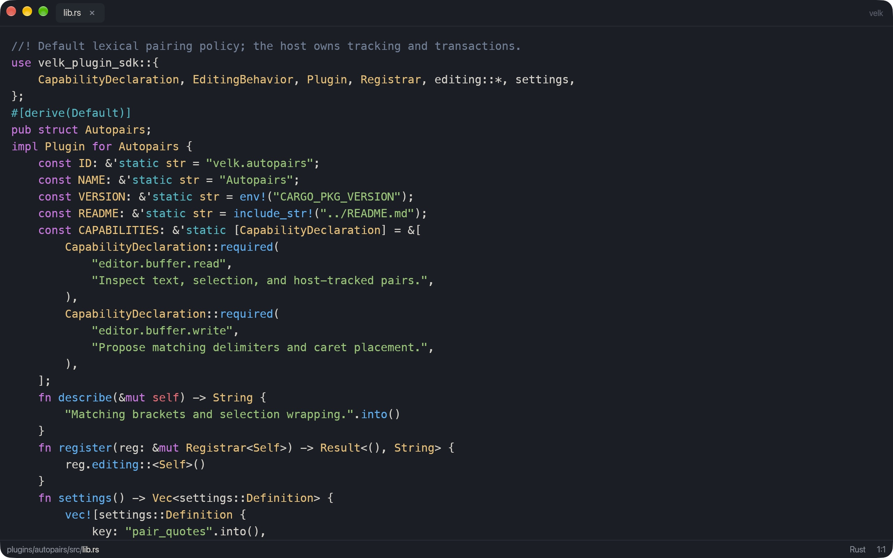
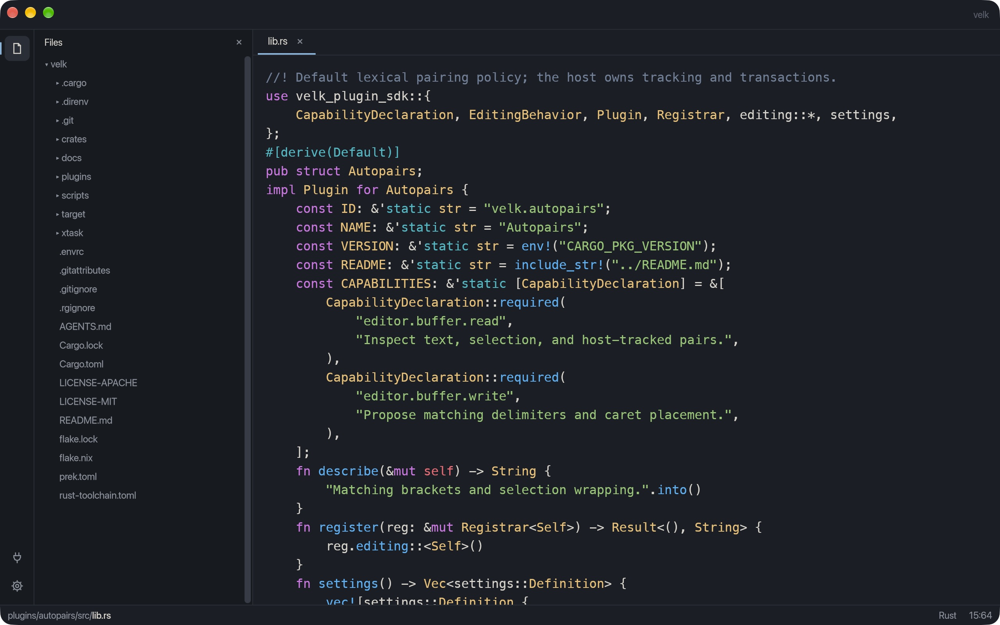
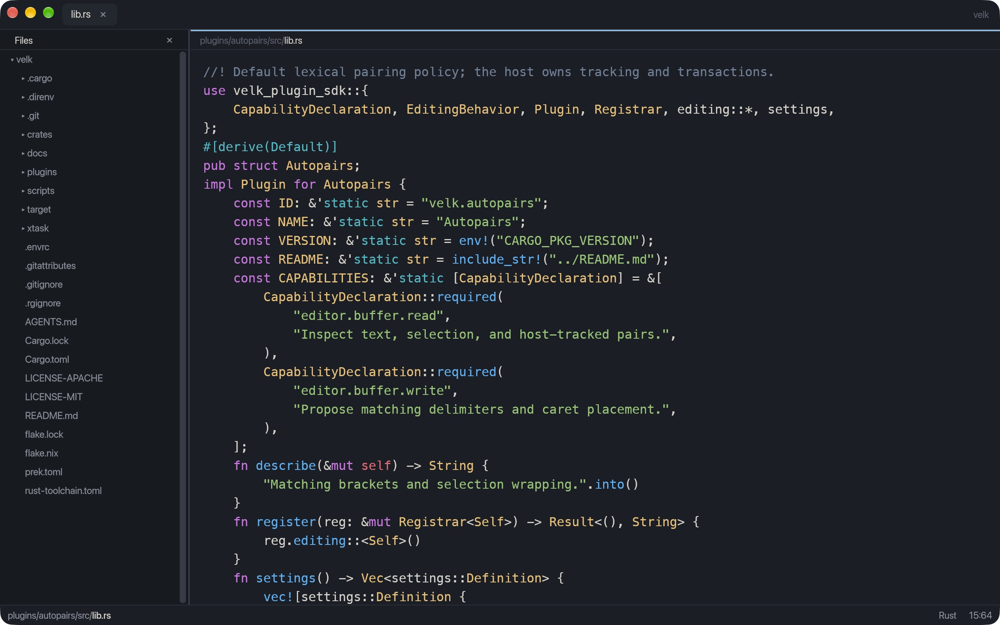
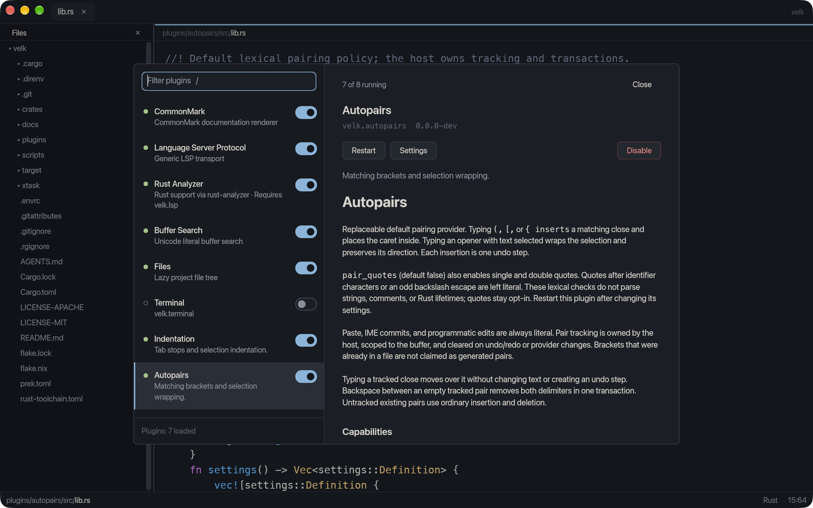

<div align="center">

# Velk

**Solving a problem nobody has: their editor is too complete.**

Built with Rust and [RXUI](https://github.com/hxyulin/rxui).

[](#project-status)
[](rust-toolchain.toml)
[](#license)

[Previews](#previews) · [Quickstart](#quickstart) · [Plugins](#plugins) · [Documentation](#documentation) · [Contributing](#contributing)

</div>

Your editor opens files, searches text, indents lines, and even closes brackets
for you. Clearly, things have gone too far.

Velk's response is to make those features plugins. File browsing? Plugin.
Search? Plugin. Markdown, language services, a terminal, indentation, and the
other half of your parentheses? Plugins. We bundle defaults so you can actually
use the editor before deciding how much of it to replace.

Under the joke is a native Rust editor built as a configurable platform. The
host owns the shared document model, edit transactions, undo history, saving,
recovery, and application shell. Feature plugins use shared contracts and UI
conventions, so replacing a behavior does not mean giving it a separate copy of
your document. The core, editor model, and rendering adapter are separate crates;
making every layer a loadable plugin is still a direction, not today's feature
list.

Today, Velk opens UTF-8 files in a GPU-rendered, rope-backed editor with multiple
buffers, Rust syntax highlighting, and bundled plugins for files, search,
language services, Markdown, indentation, autopairs, and a terminal.

## Previews

Same editor, different amounts of furniture. Choose a preset in
**Settings → Layout**, then adjust the icon rail and status line to taste.

| Quiet | Rail |
| --- | --- |
| [](docs/images/layout-quiet.jpg) | [](docs/images/layout-rail.jpg) |
| The document gets the room. Panels stay hidden until opened. | An icon rail keeps tools close, with panels in a sidebar. |

| Tiled | Plugins |
| --- | --- |
| [](docs/images/layout-tiled.jpg) | [](docs/images/plugins.jpg) |
| Plugin panels share the workspace as splits. | Inspect plugin READMEs, manage enabled features, open settings, and restart providers. |

Click a preview for the full image. These are captures of the running macOS app;
the terminal plugin is disabled in this example workspace.

## What works today

- **Native editing:** Unicode and grapheme-aware navigation, IME input,
  selection, clipboard operations, undo/redo, and virtualized text rendering.
- **Plugin-provided editing:** Tab / Shift+Tab indentation, aligned newlines, matching brackets, and selection wrapping.
- **Documents that survive interruptions:** untitled and file-backed buffers,
  Save As, Save All, atomic file replacement, disk-change conflict protection,
  and separate recovery snapshots with undo history.
- **A persistent workspace:** tab order, selections, scroll positions, workspace
  roots, and recovery state. Closing the final tab leaves the window open with
  New and Open actions.
- **A shared editor shell:** command palette, settings, docked panels, layout
  presets, and a plugin manager with enable, disable, and restart controls.
- **Rust support:** Tree-sitter highlighting and, with `rust-analyzer` installed,
  hover documentation and diagnostics through the language-service plugins.
- **Bundled tools:** a watched file tree, literal search in the current buffer,
  CommonMark rendering, and a terminal backed by Ghostty's terminal library.

## Quickstart

Velk currently runs from source. The `velk` package on crates.io is a
[name reservation](crates/velk/README.md); it does not install the application.

You will need:

- [Rust via rustup](https://rustup.rs/). The checkout pins Rust **1.99.0**, including
  its formatting and lint tools, in [rust-toolchain.toml](rust-toolchain.toml).
- Your platform's native compiler and linker tools; on macOS, install the Xcode
  Command Line Tools.
- Python 3 and `curl` for the terminal build setup.
- A graphical desktop session to launch the editor.

```sh
git clone https://github.com/hxyulin/velk.git
cd velk

# Cache the pinned Zig compiler and Ghostty terminal sources.
cargo xtask setup-terminal

# Build the editor and bundled plugins, then launch.
cargo xtask run --release

# Or open a file at startup.
cargo xtask run --release -- path/to/file.rs
```

The setup command downloads build inputs into `~/.cache/velk/toolchains` by
default; `VELK_TOOLCHAIN_DIR` overrides that location. It does not install system
packages. The first build also fetches Cargo dependencies, including pinned Git
revisions of RXUI and its rendering dependencies.

For Rust language services, install `rust-analyzer` and put it on `PATH`, or set
`VELK_RUST_ANALYZER` to its executable path. The editor can run without it.

Useful shortcuts:

- **Command/Ctrl+S:** Save.
- **Command/Ctrl+Shift+S:** Save As.
- **Command/Ctrl+Alt+S:** Save All.
- **F4:** Open the plugin manager.

Unsaved documents prompt before closing. Closing the last document keeps the
application running. See [documents and recovery](docs/document-foundation.md)
for storage behavior and the limits of external-file conflict detection.

### Build without launching

```sh
cargo xtask build --release
./target/release/velk path/to/file.rs
```

The build stages bundled native plugins beside the application in
`target/release/plugins/`. Direct launches discover that directory;
`VELK_PLUGIN_DIR` can select another plugin directory. Cargo's target-directory
overrides are respected, so adjust the executable path if you use one.

A [Nix development shell](flake.nix) supplies Zig 0.16 and `prek` on Darwin and
Linux. Rust is still managed by rustup. With Nix installed, enter it with
`nix develop`; direnv users can instead allow the included `.envrc`.

## Plugins

Velk's direction is to keep the host responsible for the editing foundation and
let plugins supply features. Common document, semantic, markup, and panel
contracts let those features share state and presentation instead of building
separate editor stacks.

The bundled pack contains:

- `velk.files`: a lazy, watched workspace file tree.
- `velk.search.literal`: Unicode-aware literal search in the active buffer.
- `velk.terminal`: a terminal session with an owned PTY and Ghostty VT processing.
- `velk.markdown`: bundled, replaceable CommonMark provider for documentation surfaces.
- `velk.lsp`: generic language-server transport and session management.
- `velk.language-server.rust-analyzer`: the Rust language-server definition.
- `velk.indentation`: Tab / Shift+Tab indentation and aligned newlines.
- `velk.autopairs`: matching brackets, selection wrapping, closer skipping, and paired deletion.
- `velk.autosave`: opt-in saves after an idle delay.
- `velk.quick-open`: fuzzy project file opening with Cmd/Ctrl+P.
- `velk.workspace-find`: workspace text search with Cmd/Ctrl+Shift+F.

Plugins declare a display name, a short description, a Markdown README, and
required or optional capabilities with explanations. The plugin manager exposes
this metadata alongside plugin state and controls. Plugins can also declare
[command palette actions](docs/plugin-commands.md); bundled actions include
definition/type/implementation navigation, references, formatting, rename, code
actions, explicit completion, Rust parent modules, and macro expansion. Plugins
propose [workspace text edits](docs/workspace-edits.md); the host validates targets
and applies changes through document transactions. Per-instance
[host services](docs/host-services.md) expose workspace context, project file
reads, current buffer text, and normal buffer lifecycle operations.

[Interactive editing providers](docs/interactive-editing.md) supply indentation
and pairing through a separate synchronous decision interface. Settings select
one provider per role; the host owns transactions, undo, caret placement, IME,
and pair tracking. Both bundled providers can be disabled or replaced.

**Native plugins are trusted code running inside the editor process.** Capability
declarations describe what a plugin needs. Host services check these declarations,
but native plugins retain ambient OS access and are not sandboxed. A plugin can
crash or block the process. The
native ABI and extension contracts are experimental: rebuild the editor and
plugins together when those contracts change.

Plugin-declared settings appear in the existing Settings page, with validation,
defaults, and Reset controls. Changes apply after an explicit plugin restart.
See [plugin settings](docs/plugin-settings.md) for the bundled options and SDK.

Start with the [plugin API guide](docs/plugin-api.md) and
[plugin pack guide](docs/plugin-packs.md). The host currently supports shared
text, tree, and grid panel models. A general interactive widget API is future
work.

## Project status

Velk is in early development at **0.0.0-dev**. Expect behavior and API changes;
there are no stable application releases or compatibility guarantees yet.
We prioritize correcting the design over preserving early decisions. Breaking
changes to APIs, plugin contracts, configuration, and storage formats are allowed;
we do not add compatibility shims, deprecated aliases, or migration machinery just
to preserve experimental behavior. Update the host, SDK, and bundled plugins
together when their contracts change. Internal contract versions stay at 1 during
this development phase; API changes do not trigger version bumps.

macOS is the primary development environment. Other platforms are not yet
release-tested.

Current limitations include:

- Language integration focuses on Rust. Completion is explicitly invoked and
  plain-text only; snippets, automatic suggestions, and server command execution
  are not yet implemented.
- Language-server sessions are currently per buffer rather than shared across
  an entire workspace.
- Disk conflicts are detected during saves, but automatic reload and interactive
  conflict resolution are still future work.
- Accessibility exposes the editor role and label, but does not yet publish
  document text and selection to assistive technology.
- Plugin capabilities, ABI compatibility, and richer widget contracts need more
  work before supporting a broad third-party plugin ecosystem.

## Documentation

- [Documents, saving, and recovery](docs/document-foundation.md)
- [Buffers](docs/buffers.md) and [edit transactions](docs/edit-transactions.md)
- [Editor shell](docs/editor-shell.md), [panels](docs/panels.md), and
  [window reloading](docs/reloading.md)
- [Plugin API and shared contracts](docs/plugin-api.md), [plugin packs](docs/plugin-packs.md), and
  [plugin settings](docs/plugin-settings.md)
- [Interactive editing, indentation, and autopairs](docs/interactive-editing.md)
- [Workspace and buffer host services](docs/host-services.md)
- [Buffer events and autosave](docs/buffer-events.md), [Quick Open and workspace search](docs/project-tools.md)
- [Plugin commands](docs/plugin-commands.md), [workspace edits](docs/workspace-edits.md),
  and [semantic services and Rust LSP](docs/semantic-services.md)
- [Core and component boundaries](docs/core.md)
- [Files](docs/files.md), [search](docs/search.md), and [terminal](docs/terminal.md)
- [Profiling and performance tooling](docs/profiling.md)

## Contributing

Build and try the editor before making a change. The workspace separates the
application shell (`crates/editor`), UI-independent document state (`crates/core`),
editor commands and presentation data (`crates/editor-model`), RXUI editor widget
(`crates/editor-widget`), shared command data (`crates/commands`), syntax and
semantic services, markup contracts, and the native plugin API, SDK, and host. Bundled feature implementations live under
`plugins/`; development commands live in `xtask/`.

Install [prek](https://prek.j178.dev/) and enable the repository hooks:

```sh
prek install
prek run --all-files
```

`prek install` installs both the pre-commit and commit-message hooks. File checks
normalize text and format Rust and TOML; the commit-message hook checks
Conventional Commits. Review and stage any formatting fixes before committing
again. See [AGENTS.md](AGENTS.md) for coding conventions and project boundaries.

After setting up the terminal build inputs, run the workspace checks:

```sh
cargo fmt --all -- --check
cargo xtask test
```

For the full check and lint commands, ensure Zig 0.16 is available on `PATH`
(or enter `nix develop`):

```sh
cargo check --workspace --all-targets --locked
cargo clippy --workspace --all-targets --locked -- -D warnings
```

`cargo xtask test-plugins` exercises the native plugin loading path. The separate
widget showcase is available with:

```sh
cargo run --locked -p velk-editor --example widget-preview --features performance -- --showcase
```

Keep `Cargo.lock` committed. Use
[Conventional Commits](https://www.conventionalcommits.org/), such as
`feat(editor): add a document command` or `fix(plugins): handle a failed load`.
For changes to shared contracts, update their documentation and consider the
host and bundled plugins together.

## License

Velk is licensed under either [MIT](LICENSE-MIT) or
[Apache-2.0](LICENSE-APACHE), at your option. Dependencies retain their own
licenses and notices.
